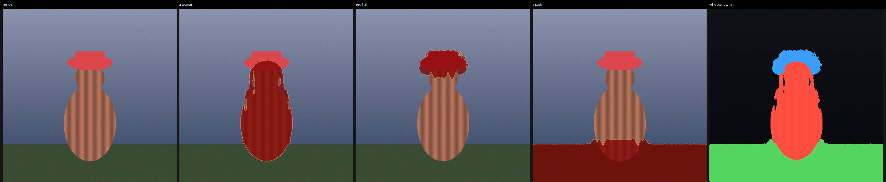
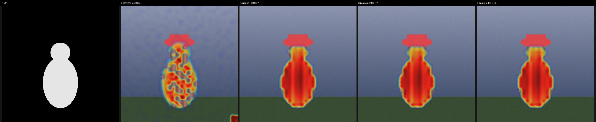

# DAAM-Mixed — карты внимания по последнему шагу

Смешанная сборка трёх работ под текущий ComfyUI, для SDXL (и SD1.5). Источники:
`nisaruj/comfyui-daam` (MIT), `alchemine/comfyui-daam-pack` (GPL-3.0) и
дипломная переработка первого из них. Снимает
cross- и self-attention карты только на нужном участке сэмплинга, чистит их
(головы, value-norm, SNR-веса по шагам, guided diffusion по self-attention),
показывает на изображении и превращает в маски пиксельного разрешения.



*Синтетическая сцена: карта внимания на сетке image/16 → пиксельная маска по
каждому тегу → карта «кто чем владеет». Нижняя цифра IoU считается тестом, а не
подрисована.*

---

## Что взято из двух паков

| | `nisaruj/comfyui-daam` (MIT) | `alchemine/comfyui-daam-pack` (GPL-3.0) | **DAAM-Mixed** |
|---|---|---|---|
| Сэмплер | свой KSampler с `start_step/last_step` | drop-in SamplerCustom, без окна шагов | **drop-in KSampler и SamplerCustom + окно шагов** |
| Запись карт | все шаги, отдельный патчер под UNet/SD3/Flux | все шаги, in-place накопление, рантайм не ломается | **окно шагов, in-place накопление** |
| Снятие патча | `set_model_patch_replace(None, …)` | так же | **ключи вычищаются из `model_options`** (None остаётся ключом, и ComfyUI его вызовет) |
| Проход по шагам вне окна | — | — | **идёт через штатное fused-ядро ComfyUI (почти бесплатно)** |
| Сетка карт | апскейл до 64×64 фиксированно | нативная image/16, мерж слоёв апскейлом | **нативная image/16, мерж слоёв байкубиком до самой мелкой** |
| Визуализация | matplotlib-оверлеи + интерактивный preview | интерактивный Tag Explorer (hover/click/pin) | **интерактивная панель на ноде: hover, click, pin, heatmap/mask/labels** |
| Маски | порог + alpha | — (структурные скоры тегов) | **guided filter до пикселя, Otsu/GMM/фикс/перцентиль, гистерезис, морфология, label map** |
| Анализ карт | — | структурные скоры тегов | **агрегация голов, value-norm, SNR-веса шагов, self-attention diffusion, мультисид** |
| Зависимости | matplotlib, fontTools | — | **numpy, scipy, Pillow (уже есть в ComfyUI)** |
| API | `set_model_patch_replace` + свой KSampler | `set_model_patch_replace` + `sample_custom` | **то же, плюс контейнеры q/k/v нового ComfyUI** |

Почему от нового пака взят именно такой сэмплер: он не подменяет ядра внимания
на весь проход, а аккуратно ставит и снимает патч вокруг одного сэмплинга и
накапливает суммы в памяти на месте. Это то, что переживает обновления ComfyUI.
Почему окно шагов: это ровно та настройка, которую вы описали — снимать карты
только с последних шагов, где атрибуция уже резкая, а шума первых шагов нет.

## Как устроено

### 1. Окно шагов

Номер шага не считается вызовами UNet (мульти-step сэмплеры вроде `dpmpp_2s`
вызывают его не по разу). Внутри патча `attn2` в `extra_options` приходят
`sigmas` (сигма текущего вызова) и `sample_sigmas` (весь расписание прохода).
Шаг = `argmin |sample_sigmas − sigmas|` — тот же приём, что ComfyUI использует
для context windows. Поэтому:

* `capture_last_steps = 1` — только последний шаг (по умолчанию);
* `capture_last_steps = 0` — все шаги;
* `capture_end_offset = 1` — сдвинуть окно на шаг назад от конца;
* `denoise < 1` и порезанные `sigmas` работают так же: «последний шаг» — конец
  именно этого прохода.

Шаги вне окна идут через штатный `optimized_attention` ComfyUI (sage/eager/…),
так что цена — секунды на весь проход, а не удвоение времени генерации.

### 2. Снятие карт

Ставятся замены на все `attn2` блоки клона модели через
`set_model_patch_replace(patch, "attn2", "input"|"middle"|"output", block, transformer)`.
Ключи ищутся по атрибуту `transformer_blocks`, а не по имени класса, поэтому не
зависят от переименований в ComfyUI.

* `q`, `k`, `v` приходят уже спроецированными; принимаются и новые
  `AttentionTensorContainer` (читается `.tensor`, а не `.peek()/take()`, чтобы не
  «съесть» владение тензором).
* головы усредняются: карта — `softmax(qkᵀ)` → `(tokens, h, w)`.
* `cond_or_uncond` из `extra_options` разделяет positive/negative и батч, а не
  форма тензора.
* накопление в `float32` на устройстве, в CPU уезжает один раз в конце.
* слои разного разрешения (latent/2, latent/4, latent/8) мержатся байкубиком до
  самой мелкой сетки — image/16 для SDXL.
* если карты никуда не подключены, патч не ставится вообще: нода стоит столько
  же, сколько обычный сэмплер.

### 3. Из карты в маску

Карта 64×64 на картинке 1024 — это 16-пиксельные клетки; байкубик даёт «плюшки»
с мягкими краями, по ним нельзя резать. Поэтому в `core/refine.py`:

1. **guided filter** (He/Sun/Tang, быстрый вариант): коэффициенты `a, b` решаются
   на грубой сетке, где живёт внимание, и применяются в пиксельном разрешении.
   Где картинка плоская — маска следует за картой внимания, на границах объектов
   — за картинкой. Край маски садится на силуэт, а не на сетку 16 px.
2. робастная нормализация (по перцентилям, чтобы одна горячая клетка — token
   sink — не владела всей шкалой);
3. порог: `auto` (Otsu, зажатый в разумный диапазон), `fixed`, `percentile`;
4. гистерезис (сильные области дорастают до половины порога);
5. морфология `open/close/grow`, выкидывание островов меньше `min_area`;
6. feather.

Плюс `label map`: каждый пиксель красится цветом тега, который его «выиграл».

## Параметры анализа (и что за ними из диплома)

Всё, что в дипломной версии было спрятано в три конфиг-ноды и три анализатора,
здесь разложено на именованные параметры. Каждый — отдельная ручка с ценой и
эффектом; ничего не «включено по умолчанию навсегда».

Про происхождение этих узлов: `DAAMCrossAttentionConfig`,
`DAAMSelfAttentionConfig`, `DAAMGuidedConfig` и три анализатора — надстройка
автора диплома над `nisaruj/comfyui-daam`, а не часть исходного пака. В
исходнике есть `CLIPTextEncodeWithTokens`, `KSamplerDAAM`, `DAAMAnalyzer` и
`DAAMPreviewImage`; всё, что в таблицах ниже, добавлено поверх них.

### На сэмплере (`DAAM KSampler (window)` / `DAAM Sampler Custom (window)`)

| Параметр | Значения | Что делает | Цена |
|---|---|---|---|
| `capture_last_steps` | 0..N | окно шагов, 1 = только последний | — |
| `capture_end_offset` | 0..N | отступить от конца | — |
| `head_aggregation` | `mean`, `median`, `max`, `min_entropy` | как склеить головы внимания слоя | median самый дорогой |
| `value_norm` | вкл/выкл | вес токена = ‖v‖: PAD и `</w>`-токены перестают шуметь | ~0 |
| `keep_per_step` | вкл/выкл | хранить карту каждого шага (≈1.3 МБ/шаг при 77 токенах) | RAM |
| `capture_self` | вкл/выкл | снимать self-attention affinity (attn1) | блоки attn1 идут не через fused-ядро |
| `self_level` | `secondary` (latent/4), `primary` (latent/2), `combined` | на какой сетке её снимать | `primary` — 4× памяти и времени |
| `self_blend` | 0..1 | доля `primary` в `combined` (0.3 как в дипломе) | — |

`min_entropy` — это тот самый отбор 25% голов с наименьшей энтропией
(`entropy_fraction`, по умолчанию 0.25): голова, которая «смотрит на всё», даёт
туман, голова, залипшая на одном слове, даёт форму. Это единственная агрегация,
которая в дипломных экспериментах стабильно выигрывала у среднего, поэтому у неё
и стоит дефолт.

### На `DAAM Guide` (постобработка, без перегенерации)

| Параметр | Значения | Что делает |
|---|---|---|
| `step_weighting` | `none`, `inverse_sigma`, `inverse_sigma_squared` | SNR-веса: поздние шаги весят 1/σ или 1/σ² |
| `self_level` | `off`, `secondary`, `primary`, `combined` | через какую affinity гнать диффузию |
| `iterations` | 0..50 | сколько проходов `H ← H·S` делать (3 — рабочая точка) |
| `threshold_mode` | `otsu`, `gmm`, `fixed`, `percentile`, `none` | что отбрасывать после каждого прохода |
| `normalize` | `minmax`, `zscore`, `none` | нормировка строки карты после прохода |
| `blend` | 0..1 | 1 — полностью уточнённая карта, 0 — исходная |

GMM — двухкомпонентная смесь гауссиан, EM 30 итераций, порог = точка
пересечения компонент (аналитически, через квадратное уравнение). На карте с
длинным низким хвостом (слово, которое модель почти не заметила) он ведёт себя
предсказуемее Otsu.

### На `DAAM Merge` (мультисид)

`heatmaps_1..4` + `mean`/`median`. Это открытая реализация «прогон одного шага
несколько раз с разным сидом»: дисперсия падает как 1/√K. Сделано отдельной
нодой, а не внутри сэмплера, по двум причинам: (1) сэмплер обязан вернуть один
латент — иначе ломается весь граф после него; (2) усреднять имеет смысл только
карты для одного и того же промпта, и это видно в графе, а не спрятано в
параметре.

### На `DAAM Masks`

`threshold_mode` теперь включает `gmm` рядом с `auto`/`otsu`/`fixed`/`percentile`,
плюс вся морфология, `min_area`, гистерезис и guided-filter апскейл (см. ниже).



*Грязная карта (дыры, спекл, «сток» внимания в углу) → 1/3/6 проходов по
self-attention affinity. IoU 0.69 → 0.92 за один проход. Affinity в этой фигуре
построен по цветам самой картинки (не по ground truth), потому что настоящую
self-attention без модели не получить; это честная замена «модель считает эти
пиксели похожими», а не подсказка ответа.*

## Что из диплома перенесено, а что нет

Дипломная версия — это `nisaruj/comfyui-daam` (MIT), взятый за основу и
существенно переработанный: добавлены конфиг-ноды, self-attention, guided
diffusion, мультисид и per-step агрегация, а поддержка SD3/Flux за ненадобностью
потерялась. Ниже — что именно из этой надстройки здесь есть, а что оставлено
в стороне.

Перенесено: отбор голов по энтропии, `median`/`max`, value-norm по ‖v‖,
per-step карты и SNR-веса (`1/σ`, `1/σ²`), self-attention affinity на двух
уровнях с `blend_alpha`, guided diffusion с порогами Otsu/GMM/fixed, мультисид
(как отдельная нода), `combined` 32+64.

Не перенесено осознанно:

* **Свой суб-квадратичный attention с возвратом полной матрицы.** Он нужен был,
  чтобы экономить VRAM при сохранении всех матриц. Здесь матрица не хранится:
  сразу агрегируются головы и суммируются карты, поэтому считаем обычный softmax
  (точнее, чем чанковый sub-quad), а на шагах вне окна вообще отдаём шаг штатному
  fused-ядру ComfyUI.
* **Подмена attn1 целиком.** Self-attention включается только когда попросили,
  и даже тогда считается чанками по запросам (пик памяти — доля от полной
  матрицы), потому что (hw, hw) на 64×64 это 268 МБ на головы.
* **Паддинг латента до кратности 8.** В ComfyUI размер латента и так кратен 8
  (иначе не соберётся UNet), а паддинг внутри сэмплера — лишний шанс разъехаться
  с выходным тензором.
* **SD3/Flux-патчеры старого пака.** Здесь только UNet cross-attention; если
  нужен DiT, это отдельная работа, и лучше её делать поверх родных хуков DiT.

Расхождение, которое стоит проверить по вашему коду: как именно считался
`value_norm` (умножение строки до или после нормировки, среднее или сумма по
‖v‖), как выбирался порог GMM (пересечение гауссиан или что-то ещё) и в каком
месте `combined` смешивал 32 и 64 до/после агрегации голов.

## Ноды

`DAAM/Mixed`:

| Нода | Что делает |
|---|---|
| **DAAM KSampler (window)** | KSampler + `latent, pos_heatmaps, neg_heatmaps` |
| **DAAM Sampler Custom (window)** | SamplerCustom + те же карты |
| **DAAM Masks** | `MASK` по каждому тегу, union, оверлеи, `labels`, список тегов |
| **DAAM Mask Cleanup** | морфология/feather для любой маски |
| **DAAM Explorer** | интерактивная панель прямо на ноде |
| **DAAM Guide (steps + self-attention)** | SNR-веса по шагам + guided diffusion по self-attention |
| **DAAM Merge (multi-seed)** | усреднение карт нескольких прогонов (mean/median) |

Порты `DAAM Masks`: `masks` (по маске на тег), `union`, `overlay` (картинка с
jet-оверлеем), `labels` (кто чем владеет), `tag_names`.

Соединять так:

```
CKPT → DAAM KSampler (window) → VAE Decode → DAAM Explorer
              │                                ▲
              └── pos_heatmaps → DAAM Guide ───┤   (опционально: SNR + self-attention)
                        │            │         │
                        │            └→ DAAM Masks ─┴→ MASK / IMAGE
CLIPTextEncode (тот же текст!) ─────────────► текст в DAAM Masks
```

`DAAM Guide` вставляется между сэмплером и масками, если нужны SNR-веса по
шагам или уточнение по self-attention. Для мультисида — несколько прогонов
`DAAM Sampler Custom (window)` с разными `noise_seed` и `DAAM Merge` на их картах.

`text` в `DAAM Masks`/`DAAM Explorer` должен быть ровно той строкой, из которой
закодировано conditioning (BREAK включительно) — иначе токены не совпадут;
нода скажет об этом прямым текстом, если количество токенов не совпало.

## Установка

```bash
cd ComfyUI/custom_nodes
git clone <этот репозиторий> ComfyUI-DAAM-Mixed
# либо скопировать только папку daam_mixed и переименовать в ComfyUI-DAAM-Mixed
```

Зависимости — `numpy`, `scipy`, `Pillow`; все три уже стоят в ComfyUI.
Перезапуск, затем категория `DAAM/Mixed`.

## Что проверено, а что нет

Три уровня, все без GPU и без чекпойнта:

```bash
# 1. Логика и ноды, ComfyUI подменён заглушками (tests/stubs)
python daam_mixed/tests/test_daam.py      # 130 проверок
# 2. JS-ядро панели: парсер .npy и отрисовка, в node
node   daam_mixed/tests/js_core_test.mjs  # 19 проверок
# 3. Картинка docs/demo.png и IoU по маскам
python daam_mixed/tests/demo_figure.py
```

Плюс две проверки против **настоящего** ComfyUI (нужен его чекаут; на машине
без GPU запускать с `COMFYUI_CPU=1`):

```bash
COMFYUI=/path/to/ComfyUI python daam_mixed/tests/integration_comfyui.py
```

* реальный `BasicTransformerBlock` + реальный `set_model_options_patch_replace`:
  что ключи доходят, что блок зовёт патч как `patch(q, k, v, extra_options)`,
  что в `extra_options` есть `sigmas`/`sample_sigmas`/`cond_or_uncond`, что карты
  выходят `(tokens, h, w)` и нормированы, что выход на записанном шаге совпадает
  с выходом без патча, и что после снятия патча ключей не остаётся;
* `nodes.load_custom_node(...)` на копии папки: семь нод регистрируются,
  `WEB_DIRECTORY` подхватывается, `INPUT_TYPES` сериализуются в JSON.

Проверено (сейчас, здесь): поиск `attn2`/`attn1`-ключей (в т.ч. при вложенных
`SpatialTransformer`), окно шагов на реальном расписании сигм (1, 0, offset),
что вне окна шаг уходит в fused-ядро, разделение pos/neg и батча по
`cond_or_uncond`, мерж слоёв до самой мелкой сетки, нарезка промпта на теги
(включая BREAK и смещение на 77 токенов), guided filter против байкубика по IoU
и по расстоянию до края, агрегация голов (что `min_entropy` не размывает карту,
как `mean`), value-norm (гасит токен с ‖v‖≈0 и сохраняет нормировку), per-step
карты + SNR-веса (что веса растут к концу расписания и что взвешенная карта
опирается на поздние шаги), захват self-attention (affinity квадратная, строки
— распределения, регион не «протекает»), guided diffusion на зашумлённой карте
(IoU 0.47 → 1.0 на синтетике), ноды `DAAM Guide`/`DAAM Merge` на реальных
payload'ах, работа остальных нод на фейковом CLIP/IMAGE, схема нод так, как её
проверяет ComfyUI при загрузке, формат `.npy` между Python и JS.

Не проверено: реальная генерация (GPU + чекпойнт), реальные веса SDXL, ваши
fused-ядра (sage/xformers), внешний вид панели в браузере. Это первый список
того, что надо прогнать у вас — и всё это есть в проверке «прогони и покажи
лог».

### Сколько это стоит (очень грубо)

Замеры на CPU в 2 потока, поэтому смотрите на соотношения, а не на абсолюты:
cross-attention 64×64 при 77 токенах и 8 головах — 28 мс, агрегация `mean` —
1 мс, `max` — 6 мс, `min_entropy` — 12 мс, `median` — 40 мс; self-attention
32×32 чанками — 53 мс. На GPU почти всё это упрётся в запуск ядер, а не в
арифметику; главный расход — не считать, а гонять каждый блок внимания через
явный softmax вместо fused-ядра, и он включается только для блоков внутри
окна шагов.

## Ограничения

* Только модели с UNet cross-attention: SDXL, SD1.5, Pony и т.п. У DiT-моделей
  (Flux, SD3, Qwen-Image) блоков `attn2` нет; нода честно предупредит в логе.
  Для Flux/SD3 нужен отдельный патчер — можно добавить следующим шагом.
* Тонкие объекты (шляпа с полями, очки) на сетке 64×64 физически не разрешаются
  лучше 16 px: маска будет чище карты внимания, но не точнее её. Для мелочи
  помогает снимать более глубокие слои (`capture` берёт все) и увеличивать
  `threshold_mode = percentile`.
* Одна карта на тег: несколько conditioning'ов с разными текстами (например,
  regional) склеиваются по количеству токенов, а не по смыслу — используйте
  разные ноды, если нужен разный текст.
